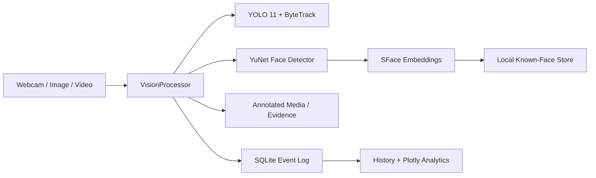

# VisionGuard AI

**Intelligent Real-Time Face & Object Detection** — a privacy-first computer-vision dashboard built for real-world portfolio demonstrations, final-year engineering projects, and extensible monitoring prototypes.

VisionGuard combines Ultralytics YOLO, ByteTrack, OpenCV YuNet/SFace, Streamlit, and SQLite to detect and track objects, register and recognize faces locally, preserve evidence, and turn detection events into useful analytics.

## Highlights

- Real-time browser-webcam detection through WebRTC
- YOLO detection across all COCO classes with confidence labels
- Persistent ByteTrack IDs for moving objects
- Dedicated YuNet face detection independent of person boxes
- Local SFace embeddings with conservative configurable matching
- Multi-image face registration and cached embeddings
- Unknown-face snapshots with cooldown protection
- Image and uploaded-video processing with downloadable results
- SQLite sessions and event-level detection history
- Plotly KPIs, object distribution, activity, identity, and session charts
- Evidence rules for unknown people, phones, laptops, and backpacks
- CSV export and privacy controls for biometric data and history
- CPU support with automatic acceleration where Ultralytics supports it

## Architecture



Models are initialized once per Streamlit process using resource caching. Face embeddings are computed at registration time and loaded from local `.npy` files. No biometric data is sent to a recognition API.

## Technology stack

Python 3.10+, Streamlit, streamlit-webrtc, OpenCV Contrib, Ultralytics YOLO 11, ByteTrack, NumPy, Pandas, Plotly, SQLAlchemy, Pillow, and SQLite.

## Quick start

```bash
git clone <repository-url>
cd visionguard-ai

python -m venv venv
source venv/bin/activate
```

Windows activation:

```bat
venv\Scripts\activate
```

Install and run:

```bash
python -m pip install --upgrade pip
pip install -r requirements.txt
streamlit run app.py
```

Open `http://localhost:8501`. The first use downloads YOLO weights and the two OpenCV Zoo face models into local caches/model storage, so an internet connection is needed once. All later inference is local.

## Using VisionGuard

### Register a face

1. Open **Face Registration**.
2. Enter a name and unique student/employee ID.
3. Upload up to three clear images (front, slight left, slight right), or use camera capture.
4. Use evenly lit, unobstructed images containing exactly one face.
5. Submit. VisionGuard averages valid embeddings and stores them locally.

The default cosine threshold is `0.45`. Raise it to reduce false acceptance; lower it carefully if genuine faces are rejected. Lighting, image quality, pose, and camera differences materially affect recognition.

### Detect media

- **Live Detection:** click START in the WebRTC component and grant camera permission.
- **Image Detection:** upload JPG/JPEG/PNG/WEBP and download the annotated JPEG.
- **Video Detection:** upload MP4/MOV/AVI/MKV, select a frame stride, process, then preview/download the result.
- **History:** filter by type, object, session, or identity and export CSV.
- **Analytics:** review KPIs and trends derived from SQLite.

## Project structure

```text
visionguard-ai/
├── app.py
├── pages/
│   ├── 1_Live_Detection.py
│   ├── 2_Image_Detection.py
│   ├── 3_Video_Detection.py
│   ├── 4_Face_Registration.py
│   ├── 5_Analytics.py
│   └── 6_Detection_History.py
├── src/
│   ├── analytics.py
│   ├── config.py
│   ├── database.py
│   ├── face_detector.py
│   ├── face_recognizer.py
│   ├── object_detector.py
│   ├── processor.py
│   ├── tracker.py
│   ├── ui.py
│   └── video_utils.py
├── assets/{logo.svg,styles.css}
├── data/{known_faces,unknown_faces,screenshots,uploads,processed}/
├── database/
├── models/
├── tests/
├── requirements.txt
└── .gitignore
```

## Database schema

- `registered_people`: profile metadata and local face/embedding locations
- `detection_sessions`: source type, start/end time, and aggregate counts
- `detections`: timestamp, class/type, confidence, track ID, identity, face similarity, and optional evidence path

SQLAlchemy creates the SQLite file and tables automatically. Queries are parameterized by the ORM. Biometric directories and the database are ignored by Git.

## How detection works

YOLO detects COCO objects and can pass detections to ByteTrack, whose IDs persist across adjacent frames. YuNet separately locates faces and five landmarks. SFace aligns each face, creates a feature vector, and compares it with averaged registered vectors using cosine similarity. The pipeline annotates the frame, applies evidence cooldowns, and returns structured events for SQLite logging.

## Performance notes

- The default `models/yolo11s.pt` improves small-object accuracy; `yolo11n` remains available as a faster option.
- Extended mode uses YOLO-World at 1280px with a focused vocabulary and low-threshold ByteTrack configuration for small/non-COCO objects such as pens, headphones, and earbuds.
- Live inference scales frames to a maximum width of 960 px.
- Video frame stride can trade temporal detail for speed.
- Resource caching prevents model reinitialization on Streamlit reruns.
- A CUDA/MPS-capable PyTorch installation may be used automatically by Ultralytics; CPU remains supported.
- For long production videos, move processing to a job queue. This portfolio version keeps processing visible and deterministic in the current session.

## Error handling and testing

The UI handles invalid media, absent faces, multi-face registration images, model/download failures, duplicate identifiers, unsupported uploads, and unavailable camera permissions with readable messages. Run local checks with:

```bash
python -m compileall app.py pages src tests
python -m unittest discover -s tests
```

Manual acceptance testing should cover one/multiple/no faces, registered/unknown faces, low light and varied poses, multiple moving objects, corrupt uploads, unavailable cameras, and representative MP4/MOV/AVI/MKV files. Hardware and codec behavior varies, so webcam and output playback should be tested on the demonstration machine.

## Privacy

Face images and embeddings are sensitive biometric data. VisionGuard processes them locally, excludes them from Git, and provides deletion controls. Obtain informed consent, restrict filesystem access, define a retention policy, and check applicable privacy/biometric laws before deployment. Deleting a profile removes its saved images and embedding; History provides separate controls for unknown captures and logs.

## Limitations

- This is not a certified identity, security, or access-control system.
- Recognition quality depends on reference images, pose, lighting, occlusion, and demographic/model bias.
- A track ID may change after prolonged occlusion or leaving the frame.
- MP4 output relies on codecs available in the local OpenCV build.
- Live event persistence is intentionally conservative; image/video sessions provide full logging.

## Future roadmap

The modular processor and database boundaries support attendance workflows, CCTV/multi-camera input, restricted-area and PPE rules, vehicle/plate detection, alert adapters (email/Telegram), cloud databases, retention policies, background job workers, and role-based access without rewriting model code.

## Screenshots

Add repository screenshots after running the app:

- `docs/screenshots/dashboard.png`
- `docs/screenshots/live-detection.png`
- `docs/screenshots/analytics.png`

## Resume-ready description

> Built VisionGuard AI, a modular real-time computer-vision platform using Python, YOLO 11, ByteTrack, OpenCV YuNet/SFace, Streamlit, SQLAlchemy, and SQLite. Implemented local face registration/recognition, unknown-person evidence capture, image/video/webcam pipelines, persistent object tracking, event logging, CSV exports, and interactive Plotly analytics with privacy controls.

## License

Choose a license appropriate for your use before publishing. Model weights and dependencies retain their respective licenses.
