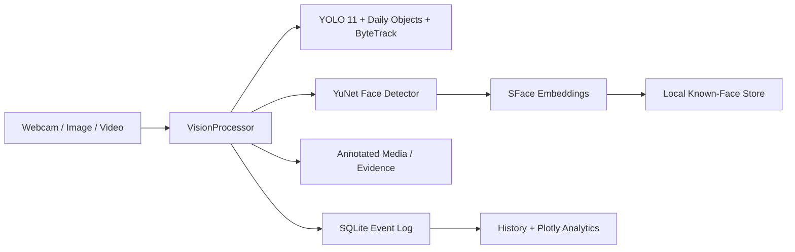

# VisionGuard AI

**Intelligent Real-Time Face & Object Detection** — a privacy-first computer-vision dashboard built for real-world portfolio demonstrations, final-year engineering projects, and extensible monitoring prototypes.

VisionGuard combines Ultralytics YOLO, ByteTrack, OpenCV YuNet/SFace, Streamlit, and SQLite to detect and track objects, register and recognize faces locally, preserve evidence, and turn detection events into useful analytics.

## Highlights

- Real-time browser-webcam detection through WebRTC
- YOLO11 detection across all 80 COCO classes plus a fine-tuned daily-object model and targeted YOLO-World verification
- Daily-use coverage for backpacks, bats, bottles, fans, cups, headphones, laptops, phones, pens, and watches
- Optional Diverse mode with an Objects365 checkpoint pretrained on 1.74 million images across 365 classes
- Persistent ByteTrack IDs for moving objects
- Dedicated YuNet face detection independent of person boxes
- Local SFace embeddings with conservative configurable matching
- Multi-image face registration and cached embeddings
- Unknown-face snapshots with cooldown protection
- Image and uploaded-video processing with downloadable results
- SQLite sessions and event-level detection history
- Plotly KPIs, object distribution, activity, identity, and session charts
- Measured inference latency, throughput benchmarking, CSV classification checks, and YOLO-format mAP evaluation tooling
- Presentation-ready project guide with methodology, demo flow, limitations, and viva questions
- Evidence rules for unknown people, phones, laptops, and backpacks
- CSV export and privacy controls for biometric data and history
- CPU support with automatic acceleration where Ultralytics supports it

## Architecture



Models are initialized once per Streamlit process using resource caching. Face embeddings are computed at registration time and loaded from local `.npy` files. No biometric data is sent to a recognition API.

## Technology stack

Python 3.10+, Streamlit, streamlit-webrtc, OpenCV Contrib, Ultralytics YOLO 11, ByteTrack, NumPy, Pandas, Plotly, SQLAlchemy, Pillow, and SQLite.

## Quick start

```bash
git clone <repository-url>
cd visionguard-ai

python -m venv venv
source venv/bin/activate
```

Windows activation:

```bat
venv\Scripts\activate
```

Install and run:

```bash
python -m pip install --upgrade pip
pip install -r requirements.txt
streamlit run app.py
```

Open `http://localhost:8501`. VisionGuard requires the selected YOLO weights to exist in `models/` and will never silently substitute another standard model. The expected files are `yolo11n.pt`, `yolo11s.pt`, and (for Extended mode) `yolov8s-worldv2.pt`. Extended mode also loads `daily_objects.pt` when the locally trained checkpoint is present. Diverse mode uses the official `yolo26s-objv1-150.pt` Objects365 checkpoint plus the same specialist passes. Obtain base checkpoints only from the official Ultralytics release mechanism. YuNet and SFace are downloaded from the official OpenCV Zoo if absent. All inference is local after setup.

## Using VisionGuard

### Register a face

1. Open **Face Registration**.
2. Enter a name and unique student/employee ID.
3. Upload up to three clear images (front, slight left, slight right), or use camera capture.
4. Use evenly lit, unobstructed images containing exactly one face.
5. Submit. VisionGuard averages valid embeddings and stores them locally.

The default cosine threshold is `0.45`. Raise it to reduce false acceptance; lower it carefully if genuine faces are rejected. Lighting, image quality, pose, and camera differences materially affect recognition.

### Detect media

- **Live Detection:** click START in the WebRTC component and grant camera permission.
- **Image Detection:** upload JPG/JPEG/PNG/WEBP and download the annotated JPEG.
- **Video Detection:** upload MP4/MOV/AVI/MKV, select a frame stride, process, then preview/download the result.
- **History:** filter by type, object, session, or identity and export CSV.
- **Analytics:** review KPIs and trends derived from SQLite.
- **Model Performance:** benchmark the selected pipeline and evaluate labeled `actual`/`predicted` results.
- **Project Guide:** use the built-in explanation and demo sequence during a college presentation.

## Project structure

```text
visionguard-ai/
├── app.py
├── pages/
│   ├── 0_Dashboard.py
│   ├── 1_Live_Detection.py
│   ├── 2_Image_Detection.py
│   ├── 3_Video_Detection.py
│   ├── 4_Face_Registration.py
│   ├── 5_Analytics.py
│   ├── 6_Detection_History.py
│   ├── 7_Model_Performance.py
│   └── 8_Project_Guide.py
├── src/
│   ├── analytics.py
│   ├── config.py
│   ├── database.py
│   ├── face_detector.py
│   ├── face_recognizer.py
│   ├── object_detector.py
│   ├── performance.py
│   ├── processor.py
│   ├── tracker.py
│   ├── ui.py
│   └── video_utils.py
├── assets/{logo.svg,styles.css}
├── docs/TECHNICAL_AUDIT.md
├── evaluation/{README.md,dataset.example.yaml}
├── scripts/evaluate_object_detection.py
├── scripts/prepare_openimages_daily_objects.py
├── scripts/train_daily_objects.py
├── data/{known_faces,unknown_faces,screenshots,uploads,processed}/
├── database/
├── models/
├── tests/
├── requirements.txt
└── .gitignore
```

## Database schema

- `registered_people`: profile metadata and local face/embedding locations
- `detection_sessions`: source type, start/end time, and aggregate counts
- `detections`: timestamp, class/type, confidence, detector source, track ID, identity, face similarity, and optional evidence path

SQLAlchemy creates the SQLite file and tables automatically. Queries are parameterized by the ORM. Biometric directories and the database are ignored by Git.

## How detection works

YOLO11 detects COCO objects and can pass detections to ByteTrack, whose IDs persist across adjacent frames. In Extended mode, a fine-tuned ten-class YOLO model supplies conservative daily-object evidence and a separate tiled YOLO-World pass searches for targeted open-vocabulary objects. Diverse mode replaces the 80-class primary pass with an official 365-class Objects365 model pretrained on 1.74 million images. Events are stored with their actual detector source, and class-aware fusion removes overlapping lower-quality guesses. YuNet separately locates faces and five landmarks. SFace aligns each face, creates a feature vector, and compares it with averaged registered vectors using cosine similarity. The pipeline annotates the frame, applies evidence cooldowns, and returns structured events for SQLite logging.

Standard YOLO11 COCO weights do **not** contain pen, earbuds, headphones, or wristwatch classes. Confidence changes cannot add missing categories. Accurate and Fast modes therefore report only the labels actually produced by their COCO model. Use Extended mode for the custom daily-object checkpoint and open-vocabulary pass.

### Rebuild the daily-object model

The dataset builder downloads licensed Open Images annotations and images, keeps provenance, creates deterministic train/validation/test splits, and writes YOLO-format labels. Generated data, runs, and weights remain local and are ignored by Git.

```bash
.venv/bin/python scripts/prepare_openimages_daily_objects.py --images-per-class 60
.venv/bin/python scripts/train_daily_objects.py --epochs 20 --imgsz 512 --batch 8
```

The current 598-image run reached `0.649` mAP@0.50 and `0.493` mAP@0.50:0.95 on its untouched 90-image Open Images test split. This is a reproducible benchmark, not a guarantee of error-free webcam detection; room-specific labeled images are still the best next step for domain adaptation.

## Performance notes

- The default `models/yolo11s.pt` runs at 960px and uses test-time augmentation for still images to improve small-object recall; `yolo11n` remains available as a faster 640px option.
- Accurate mode (YOLO11s) is the recommended default for standard COCO objects. Extended mode adds the fine-tuned daily-object model and a separately sourced YOLO-World pass with class-aware duplicate fusion.
- Diverse mode covers 365 base classes before the specialist passes, but is slower and does not imply error-free recognition of arbitrary objects.
- Defaults are YOLO11 confidence `0.35`, NMS IoU `0.50`, YOLO-World confidence `0.02`, and up to 300 detections. These are operating defaults, not validated optimums.
- Live Fast mode scales frames to at most 960 px; Accurate and Experimental modes retain up to 1280 px before model letterboxing.
- Video frame stride can trade temporal detail for speed.
- Resource caching prevents model reinitialization on Streamlit reruns.
- Object-model caches are browser-session scoped because ByteTrack state is mutable; a new camera or uploaded video resets its trackers.
- A CUDA/MPS-capable PyTorch installation may be used automatically by Ultralytics; CPU remains supported.
- For long production videos, move processing to a job queue. This portfolio version keeps processing visible and deterministic in the current session.

## Error handling and testing

The UI handles invalid media, absent faces, multi-face registration images, model/download failures, duplicate identifiers, unsupported uploads, and unavailable camera permissions with readable messages. Run local checks with:

For a live presentation, follow the conservative setup and rehearsal steps in [`docs/DEMO_CHECKLIST.md`](docs/DEMO_CHECKLIST.md). Live Detection enables Demo Safe Mode by default, requiring two matching frames before a non-person object is displayed.

```bash
python -m compileall app.py pages src tests
python -m unittest discover -s tests
```

For real object-detection accuracy metrics, create a held-out YOLO-format dataset using [`evaluation/dataset.example.yaml`](evaluation/dataset.example.yaml), then run:

```bash
.venv/bin/python scripts/evaluate_object_detection.py \
  --data evaluation/dataset.yaml --mode accurate --split test \
  --output evaluation/accurate-results.json
```

This reports precision, recall, F1, mAP@0.50, mAP@0.50:0.95, per-class results, false positives/negatives, and latency. The downloaded Open Images subset is ignored by Git; its last held-out metrics are summarized above. See [`evaluation/README.md`](evaluation/README.md) and [`docs/TECHNICAL_AUDIT.md`](docs/TECHNICAL_AUDIT.md).

Manual acceptance testing should cover one/multiple/no faces, registered/unknown faces, low light and varied poses, multiple moving objects, corrupt uploads, unavailable cameras, and representative MP4/MOV/AVI/MKV files. Hardware and codec behavior varies, so webcam and output playback should be tested on the demonstration machine.

## Privacy

Face images and embeddings are sensitive biometric data. VisionGuard processes them locally, excludes them from Git, and provides deletion controls. Obtain informed consent, restrict filesystem access, define a retention policy, and check applicable privacy/biometric laws before deployment. Deleting a profile removes its saved images and embedding; History provides separate controls for unknown captures and logs.

## Limitations

- This is not a certified identity, security, or access-control system.
- Recognition quality depends on reference images, pose, lighting, occlusion, and demographic/model bias.
- Accurate/Fast YOLO11 modes cannot detect categories outside their 80 COCO labels; Extended mode adds ten trained daily-use classes, but neither the custom model nor YOLO-World can guarantee arbitrary-category detection.
- A track ID may change after prolonged occlusion or leaving the frame.
- MP4 output relies on codecs available in the local OpenCV build.
- Live event persistence is intentionally conservative; image/video sessions provide full logging.

## Future roadmap

The modular processor and database boundaries support attendance workflows, CCTV/multi-camera input, restricted-area and PPE rules, vehicle/plate detection, alert adapters (email/Telegram), cloud databases, retention policies, background job workers, and role-based access without rewriting model code.

## Screenshots

Add repository screenshots after running the app:

- `docs/screenshots/dashboard.png`
- `docs/screenshots/live-detection.png`
- `docs/screenshots/analytics.png`

## Resume-ready description

> Built VisionGuard AI, a modular real-time computer-vision platform using Python, YOLO 11, ByteTrack, OpenCV YuNet/SFace, Streamlit, SQLAlchemy, and SQLite. Implemented local face registration/recognition, unknown-person evidence capture, image/video/webcam pipelines, persistent object tracking, event logging, CSV exports, and interactive Plotly analytics with privacy controls.

## License

Choose a license appropriate for your use before publishing. Model weights and dependencies retain their respective licenses.
